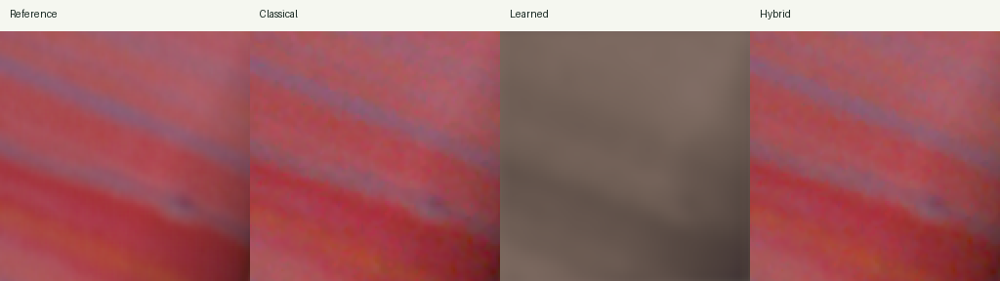
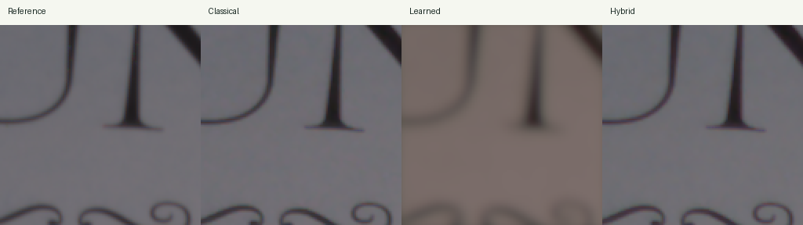

# Failure analysis

Retrospectively selected difficult examples from the frozen 64-patch test report; not a new independent evaluation or model-selection set.

## learned_perceptual_error — 0198-003 (scene 010)

Learned LPIPS 0.4894, versus classical 0.0521; learned colour error 18.24, versus classical 1.48.

## hybrid_tradeoff — 0198-023 (scene 010)

Hybrid LPIPS 0.0193, versus classical 0.0125; hybrid PSNR 40.98 dB, versus classical 39.79 dB. Metrics capture different trade-offs.

## Limits

- Two physical test scenes cannot establish broad camera generalization.
- Clean RAW targets use approximate colour calibration.
- Synthetic dark/noisy and colour-cast stress results are distinct from real capture evaluation.
- LPIPS and pixel fidelity can disagree; inspect images alongside multiple metrics.

## Learned-model follow-up

Three isolated training experiments were evaluated on the same 64 development-validation patches. Test patches were not used for selection. No candidate passed the combined PSNR, SSIM, colour-error and LPIPS gate; production weights were retained.

| Candidate | Validation PSNR | SSIM | Delta E | LPIPS |
|---|---:|---:|---:|---:|
| final-learned | 24.4154 | 0.9225 | 10.6538 | 0.2745 |
| learned-detail-candidate | 24.7144 | 0.9188 | 10.8559 | 0.2725 |
| learned-detail-refine | 24.7530 | 0.9217 | 10.9388 | 0.2756 |
| learned-detail-expanded | 25.3538 | 0.9259 | 11.6093 | 0.2798 |

The expanded trial adds two high-ISO captures from training scenes 003/004, increasing training patches from 192 to 256 while preserving all scene assignments. Higher PSNR alone did not establish better overall reconstruction. Full measured results and configurations are in learned_improvement_trials.json.
