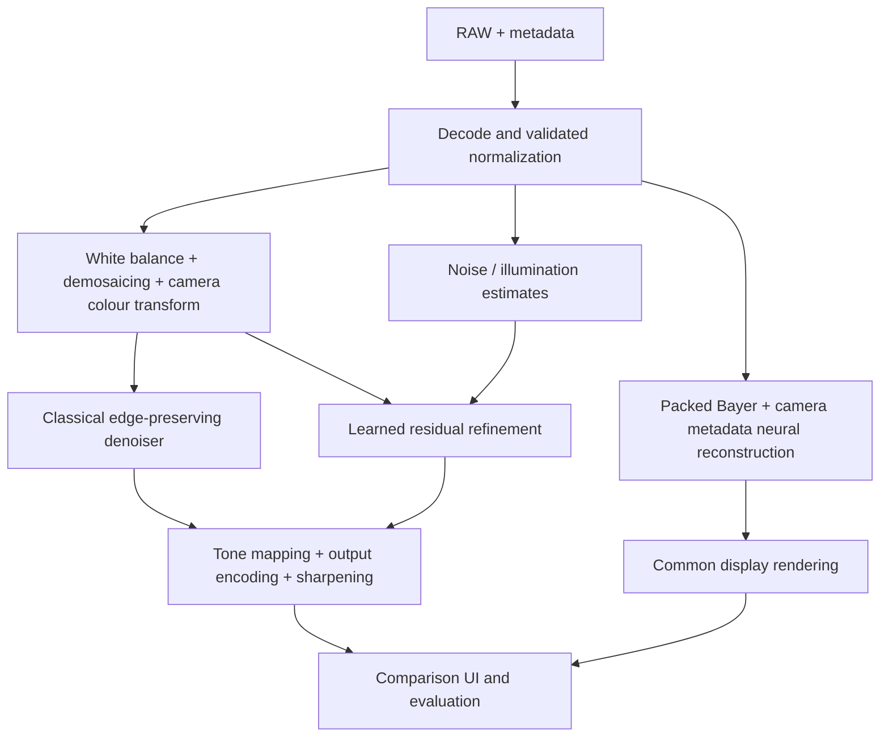

# Architecture

Classical array inference, paired training, learned-only packed-Bayer reconstruction, and checkpoint-based hybrid inference are implemented. The learned-only network supports versioned subpixel-v1 and resize/convolution-v2 output heads. Schema 3 gives all paths the same RAW context and crops neural outputs to central targets. Direct DNG decoding and deployment optimization remain pending. Locally generated pilot weights are Git-ignored; classical remains the strongest pilot method.

All methods must produce the same target RGB encoding and spatial dimensions. Learned-only and hybrid paths have distinct model/input contracts. Input normalization shared between methods is not an enhancement baseline.
