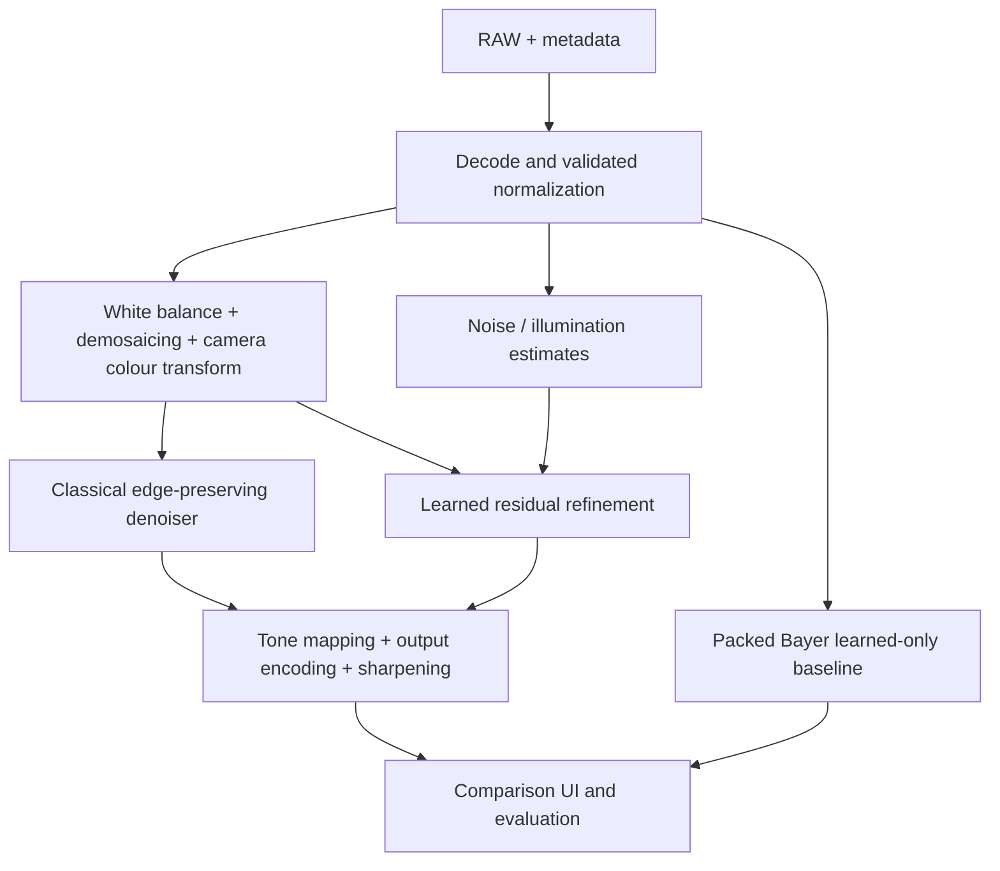

# Architecture

This diagram is the intended architecture; only foundational utilities and the untrained refinement model currently exist.

All methods must produce the same target RGB encoding and spatial dimensions. Learned-only and hybrid paths have distinct model/input contracts. Input normalization shared between methods is not an enhancement baseline.
