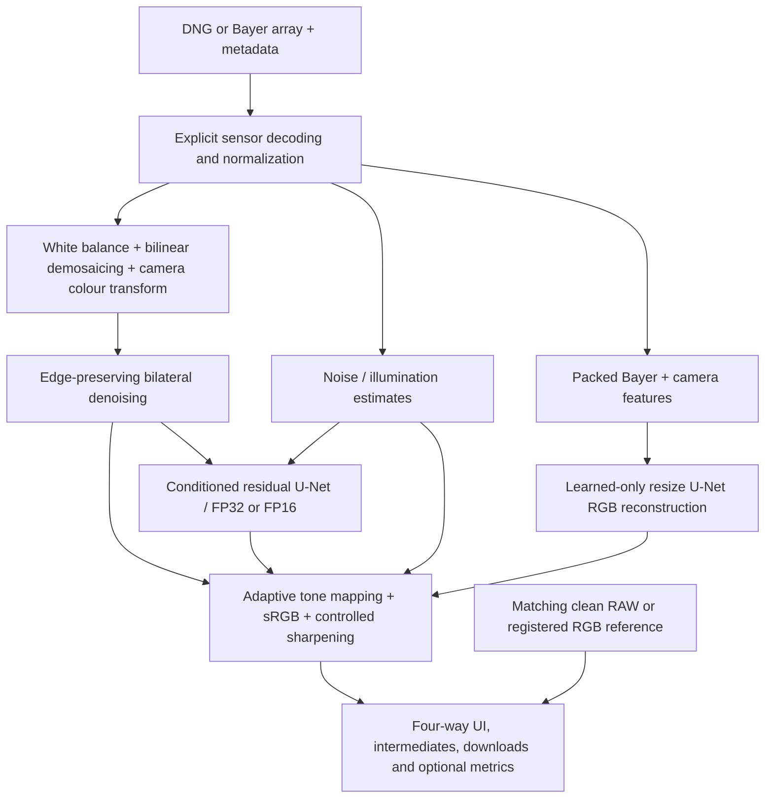

# Implemented architecture

The common display renderer makes output encoding comparable; learned-only does not use classical demosaicing, white-balance multiplication, matrix multiplication or denoising before its network. Training/evaluation share equal RAW context and crop predictions to central targets. Full app inference returns the selected even-sized sensor crop.

Data preparation freezes physical-scene assignments before patching. Training chooses checkpoints on validation. The optimization step selects residual blending on validation and exports FP16. Fresh-scene quality, ablations/stress tests, isolated CPU benchmarks and registration checks feed measured reports. The app consumes only final weights and small sample crops, not the full training set. Public hosting is separate from this verified local architecture.
