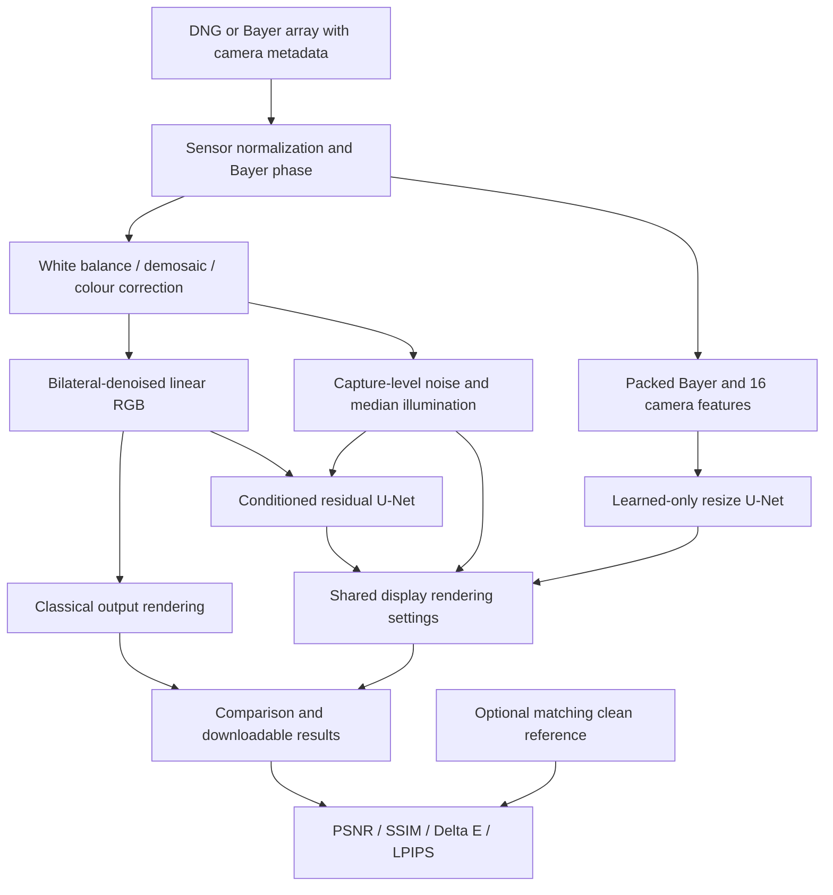
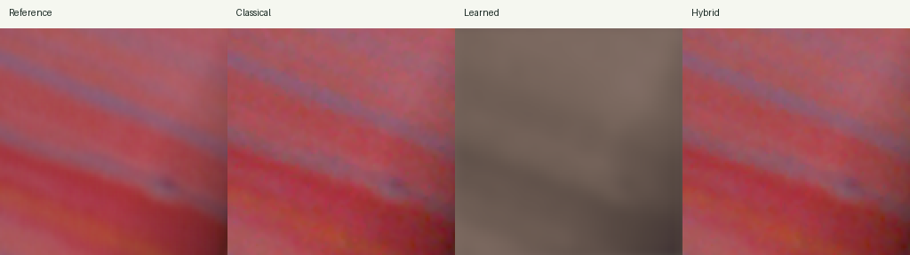
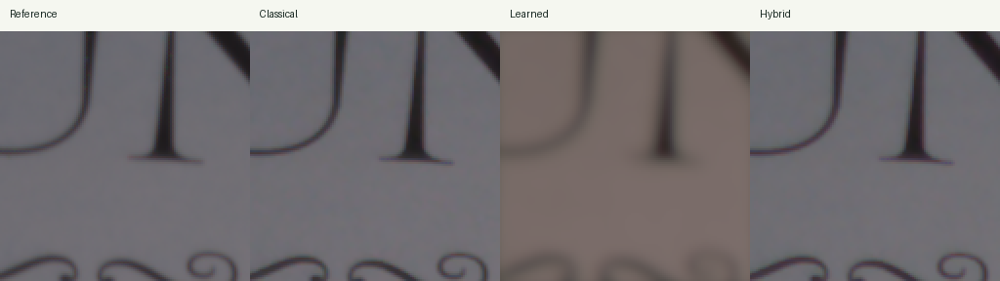
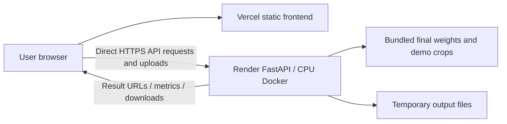

1RUA24CSE0371,1RUA24CSE0365

# Hackathon Technical Solution Report

| Field | Details |
| :--- | :--- |
| **Problem ID** | P2 |
| **Problem Title** | Intelligent and Computationally Efficient Smartphone ISP |
| **Team Name** | NOCTICS — Team ID: T47; Section: D |
| **Team Members** | Ritik Singh — 1RUA24CSE0371; Rishab Patil — 1RUA24CSE0365 |
| **GitHub Repository** | [Hey-Ritik/PrismRAW](https://github.com/Hey-Ritik/PrismRAW). Reviewed submission snapshot: `4c73386ddac3e6322a616ec784eb5e1e48ff76be`. |
| **Live Demo / Deployment** | [Vercel frontend](https://prismraw-frontend.vercel.app/) · [Render backend](https://prismraw.onrender.com) |

**Draft and authorship notice.** This is an AI-assisted report draft prepared from audited repository evidence and user-supplied information. Explanatory prose, tables, captions and diagrams were assembled with Codex assistance. The tagged student placeholders require genuine student explanation or verification. No AI-content percentage is certified. Read the separate [AI Assistance Declaration](AI_Assistance_Declaration.md) and [Student Contribution Passages](Student_Contribution_Passages.md) before submission.

**Public deployment and file separation.** The application frontend is hosted on [Vercel](https://prismraw-frontend.vercel.app/) and the backend is hosted on [Render](https://prismraw.onrender.com). The student reports personally testing the deployed application; unspecified test cases and outcomes are not inferred. The original required evaluation remains a separate file at [backend/reports/eval_P2_T47.md](../../backend/reports/eval_P2_T47.md). This longer technical draft does not replace or merge that evaluation. Historical source links identify the audited experiment snapshot; their older deployment-status wording is not the current deployment status.

**Evidence and revision boundary.** The reviewed snapshot is identified above; it is not represented as the original commit of every experiment. Quality results, historical benchmarks and later optimization measurements are separate saved runs. The original evaluation records do not consistently embed their generating Git commit. This report review did not rerun the complete evaluation or a fresh installation.

---

## 1. Problem Understanding & Solution Strategy

* **Core Technical Challenge:** Smartphone Bayer sensors record incomplete colour measurements affected by noise and illumination. Reconstruction must recover RGB structure, correct white balance and colour, and suppress noise without unnecessarily smoothing detail. P2 also requires measurable computational efficiency: a useful reconstruction cannot be judged only by image-quality scores while ignoring latency, stored model size and process memory.

  PrismRAW addresses this through a bounded-crop CPU research prototype. It supports Bayer RAW data and explicit camera metadata; it does not demonstrate full-resolution real-time processing on a smartphone. The principal observed weaknesses are learned-only colour/detail errors, severe degradation under synthetic stress, and CPU inefficiency of FP16 inference. The implementation and scope are documented in [S1], [S2] and [S3].

* **Proposed Methodology:** PrismRAW compares a transparent classical ISP, a compact learned-only Bayer-to-RGB U-Net, and a hybrid that refines classically processed linear RGB with a conditioned residual U-Net. Capture-level noise and illumination estimates control denoising, exposure and sharpening, while common display rendering and matching clean-RAW references make the reconstruction comparisons interpretable. Validation selects checkpoints and hybrid residual strength; held-out scenes support the recorded test comparison.

**[STUDENT-1 — genuine explanation required]** Explain your understanding of P2 and the constraints you considered important. State why you accepted or selected this strategy, only to the extent that this reflects your actual involvement; do not claim personal design decisions that were made by AI assistance or someone else.

---

## 2. Technical Architecture & Implementation

> No raw application source files are reproduced. Module paths and source links identify the implementation; diagrams summarize the verified system.

### 2.1 Classical Algorithmic Baseline

* **Algorithms Utilized:** The classical pipeline performs sensor normalization, Bayer-domain white balance, normalized bilinear demosaicing, camera-to-linear-sRGB colour correction, a 5 × 5 bilateral filter, exposure adjustment, luminance-based tone mapping, sRGB encoding and controlled sharpening. Relevant modules are `backend/src/smartphone_isp/pipelines/classical.py` and `backend/src/smartphone_isp/classical/stages.py` [S3].

  DNG loading uses visible sensor measurements and rawpy/LibRaw metadata rather than a hidden `rawpy.postprocess()` ISP. It applies per-channel sensor levels and an approximate single-illuminant colour transform. NPY, NPZ and MAT inputs require an explicit normalization state, Bayer pattern, RGB white-balance gains and camera-to-linear-sRGB matrix. JPEG/PNG photographs are not treated as RAW inputs. Bayer phase is preserved through even-offset cropping; sensor orientation is preserved rather than automatically rotated [S14].

* **Adaptive Selection Logic:** Noise is estimated using the median absolute deviation of same-colour horizontal sensor differences, scaled by 0.6745 × √2. Let n denote this estimate and m the median nonnegative linear luminance. The adaptive settings are:

  - Bilateral range sigma: clip(2n, 0.005, 0.08).
  - Exposure gain: clip(0.18 / max(m, 0.0001), 0.5, 3).
  - Sharpening strength: 0.15 / (1 + 20n).

  Fixed mode uses sigma 0.03, exposure 1.0 and sharpening 0.15. Tone mapping divides exposed RGB by one plus exposed luminance before sRGB encoding. These statistics are global to the processed capture; they are not spatially varying learned attention or an illumination-decomposition map.

**[STUDENT-2 — genuine explanation required]** Explain, in your own technical reasoning, the trade-off between noise suppression and detail retention. Discuss why increasing exposure can make noise visible, and why capture-level adaptation may be insufficient for mixed lighting.

### 2.2 Deep Learning Pipeline

* **Model Architecture:** The learned-only `ResizeRawToRGBNet` is a compact U-Net-style encoder–decoder with convolution/ReLU blocks, average-pooling downsampling, skip connections and a resize/convolution RGB output head. Its input consists of four packed Bayer channels plus 16 camera-feature maps: three white-balance gains, nine colour-matrix entries and four one-hot CFA indicators. It reconstructs linear RGB before shared display rendering. Classical demosaicing, white-balance multiplication, CCM application and denoising are not performed before this network [S4].

  The hybrid `ResidualUNet` receives three linear-RGB channels and two constant spatial condition maps carrying estimated noise and median illumination. A zero-initialized residual head supports identity-like initialization. Both deployed architectures use base width 16. The learned-only model has 123,459 parameters and a 503,183-byte checkpoint; the hybrid has 118,595 parameters and a 483,245-byte FP32 checkpoint. These stored checkpoint sizes include more than raw parameter bytes [S4, S6].

* **Loss Functions & Training:** The original final models were trained for 30 CPU epochs with batch size 4, Adam, seed 42, two PyTorch threads and gradient-norm clipping at 1.0. Learning rates were 0.0002 for learned-only and 0.0001 for hybrid. The objective is linear-RGB L1 reconstruction plus 0.05 times the sum of horizontal and vertical L1 gradient-consistency losses. LPIPS is an evaluation metric here, not the recorded final training loss. Original final-run augmentation was disabled.

  The saved production checkpoints both record epoch 29, selected by validation linear-RGB L1. Thirty training epochs and an epoch-29 selected checkpoint are therefore consistent. Architecture, configuration, manifest hash and epoch are stored in the checkpoints [S5].

  Training uses SIDD-CC at revision `5eb2ab6375d7f99f36b59bb5aacb46af18409412`. The original experiment uses ten captures from ten physical scenes spanning Samsung S6, Google Pixel, Nexus 6, iPhone 7 and LG G4. Physical scenes 003–008 supply 192 training patches; 001/002 supply 64 validation patches; 009/010 supply 64 test patches. Each scene supplies 32 deterministic 128 × 128 target patches. Four sensor pixels of context are supplied on every side, with prediction/loss cropped to the central target. Scene separation is frozen before patch extraction [S2, S7].

  Targets are approximate fixed renderings of matching clean RAW. They are not independently captured, perfectly calibrated RGB photographs. Coarse same-CFA translational checks reported zero displacement at the tested resolution for the ten original pairs, without proving local or subpixel registration [S7].

  Three later fine-tuning trials explored Bayer-safe augmentation, stronger gradient loss, lower-rate refinement and two additional high-ISO training captures. Expanded training had 256 patches with unchanged physical-scene assignments and equivalent validation arrays. The expanded trial improved validation PSNR from 24.4154 to 25.3538 dB but worsened Delta E from 10.6538 to 11.6093 and LPIPS from 0.2745 to 0.2798. No candidate passed the combined promotion gate, so no candidate replaced production weights. These are validation experiments, not replacements for the test table [S8].

**[STUDENT-3 — genuine explanation required]** Explain the architecture and scene-level leakage safeguards in your own words. Describe your actual role in inspecting training, interpreting candidate rejection, or checking results; leave individual activity claims out if you did not perform them.

### 2.3 Hybrid Integration & Adaptive Mechanism

* **Fusion Strategy:** Classical stages supply bilateral-denoised linear RGB. The residual U-Net predicts a correction conditioned on noise and illumination. Refinement is combined as source + α × (network output − source); validation selected α = 1.0 from 0, 0.25, 0.5 and 1.0. Common exposure/tone mapping, encoding and sharpening follow refinement. The condition maps contain capture-level scalars, not measured local attention maps [S4, S6].

* **Decision Logic:** More estimated noise changes denoising and reduces sharpening; lower median illumination can raise exposure within a bounded range. The system does not choose a winning model from reference metrics during ordinary reconstruction. Quality highlights compare available results only when an aligned reference exists.

  Computational changes reuse bilateral scratch buffers, skip a classical render discarded by standalone hybrid inference, share denoised classical stages inside the comparison, and render learned output once with the intended sharpening. Optional FP16 is loaded only on request. Reuse retains one float32 RGB buffer: approximately 0.75 MiB at 256 × 256. It is a time/memory trade-off, not proof of lower peak RAM [S9, S10].

**Figure 1 — architecture schematic.** This AI-assisted schematic is derived from source modules and the existing `docs/architecture.md`; it is not an experimental image.



**[STUDENT-4 — genuine explanation required]** Explain where classical information enters hybrid reconstruction, why model outputs need display rendering, and what the architecture does not establish about spatially non-uniform illumination.

---

## 3. Experimental Benchmarks & Evaluation

### 3.1 Quantitative Benchmarks

The faculty table is retained below. Its perceptual column reports LPIPS v0.1 with SqueezeNet; NIQE was not implemented or measured.

| Approach / Model Variant | PSNR (dB) ↑ | SSIM ↑ | Perceptual Metric (LPIPS / NIQE) ↓ | Latency (ms / frame) |
| :--- | :---: | :---: | :---: | :---: |
| **Classical Baseline** | 38.4589 | 0.8867 | 0.1042 (LPIPS-Squeeze) | 44.39 |
| **Deep Learning Only** | 25.1178 | 0.9280 | 0.2893 (LPIPS-Squeeze) | 22.42 |
| **Proposed Hybrid System** | 39.2312 | 0.9027 | 0.0936 (LPIPS-Squeeze) | 77.83 |

**Quality methodology.** PSNR, SSIM, CIEDE2000 Delta E and LPIPS are arithmetic means over 64 target patches from two physical test scenes, 009/010. Inputs and matching clean references share the noisy-input-derived display exposure. RGB metrics operate on float sRGB in [0,1]; Delta E uses Lab D65. LPIPS uses the pretrained SqueezeNet backbone and normalized inputs in [−1,1]. These are local research results, not official benchmark rankings or absolute camera-colour measurements [S2].

**Latency methodology.** The table's latency column is median warmed array-processing time from a separate 256 × 256 sensor capture, with two PyTorch threads, three warmups and 20 timed runs. It excludes loading, file I/O, network and metric calculation. These are not 128-patch timing averages, full-resolution frames, Render measurements or on-device smartphone timings. The recorded machine is Windows with an Intel64 Family 6 Model 141 processor, 12 logical CPUs and PyTorch 2.7.1 CPU. The exact processor retail name is not recorded [S9].

**Resource context.**

| Pipeline | Parameters | Checkpoint size (decimal MB) | Isolated process RSS (MiB) |
|---|---:|---:|---:|
| Classical | 0 | 0.0000 | 197.49 |
| Learned-only | 123,459 | 0.5032 | 238.73 |
| Hybrid FP32 | 118,595 | 0.4832 | 272.14 |

The RAM column is isolated process RSS, including runtime overhead; it is not model-only memory, total hosted application memory or a smartphone memory measurement. Stored full-application smoke records sampled approximately 475–494 MiB across different local runs. They cannot establish the deployed service's peak memory or reliable operation within a hosting limit.

**Optimization results.** The controlled standalone hybrid comparison measured 103.69 → 77.83 ms, a 24.94% reduction; classical measured 62.52 → 44.39 ms, a 28.99% reduction. The learned-only path was unchanged in that experiment, so its approximately 1.87% difference is not claimed as an optimization. The historical `benchmark.json` measured 99.47/41.48/153.79 ms for classical/learned/hybrid using ten runs. These older observations must not be combined with the fresh observations to claim a controlled speedup [S6, S9].

A separate complete-comparison experiment measured 670.27 → 641.19 ms, a 4.34% reduction with all three methods, LPIPS, PNGs, JSON and ZIP creation included. HTTP and network time were excluded. In application reports, hybrid timing includes its attributed shared classical cost; incremental timings are recorded separately. Per-method totals should not be summed to estimate request wall time [S10].

The production weights remain unchanged. Optimization records establish exact tested image/metric equality for specified cases, including all four demo scenes at 64px with adaptation on/off and optional FP16 for scene 003. They are not a newly rerun complete 64-patch quality evaluation at the reviewed commit.

* **Analysis:** Hybrid improves PSNR, SSIM, Delta E and LPIPS relative to classical on the recorded test set, at greater processing cost. Learned-only is faster and has higher SSIM, but its lower PSNR and higher colour/perceptual error prevent interpreting that SSIM as overall superiority. The results support a measured quality/latency trade-off within this limited dataset.

**[STUDENT-5 — genuine explanation required]** Independently explain the conflicting metrics and distinguish pipeline latency, total comparison time, startup delay and network time. Do not claim statistical significance, universal speedup or mobile performance without additional evidence.

### 3.2 Visual Outputs & Intermediate Representations

The application provides sensor preview, white-balanced mosaic, demosaiced camera RGB, colour-corrected RGB and denoised/tone-mapped previews. It does not expose Retinex reflectance, spatial illumination-decomposition or learned edge-attention maps; those generic examples in the template must not be presented as implemented outputs [S3, S14].

1. **Extreme low-light:** **[FIGURE 2 — STUDENT EVIDENCE REQUIRED]** Insert a genuine low-light example with sensor preview, clean reference and classical/learned/hybrid outputs. Record scene, crop, adaptive setting and reference provenance. The existing Samsung S6 scene is labelled low light, but that label alone does not establish an extreme-low-light benchmark. Synthetic dark/noisy stress is reported separately.
2. **Non-uniform / backlit scenes:** **[FIGURE 3 — STUDENT EVIDENCE REQUIRED]** Supply an actual documented non-uniform/backlit example with a bright-region crop. Describe visible clipping and colour/detail behaviour without asserting successful preservation from an unprovided screenshot.
3. **Intermediate states:** **[FIGURE 4 — STUDENT EVIDENCE REQUIRED]** Capture and caption the actual implemented intermediate stages from the same input and settings. Do not substitute representations the system does not compute.

**Figure 5 — committed learned-only failure example.** Sample `0198-003`, physical test scene 010. The existing figure places reference, classical, learned-only and hybrid left to right. Its source is `backend/reports/failure_examples/learned_perceptual_error.png` [S11]. It is a retrospectively chosen difficult example, not an additional independent benchmark.



**Figure 6 — committed metric trade-off example.** Sample `0198-023`, scene 010, in the same left-to-right order. Source: `backend/reports/failure_examples/hybrid_tradeoff.png` [S11]. Pixel fidelity and perceptual distance favor different conclusions; Section 4 gives the recorded values.



**[STUDENT-6 — genuine observations required]** Inspect these figures yourself and write your observations about colour, texture, edges and noise. Label the final figure numbers consistently after adding the missing figures. Confirm that the Mermaid diagrams render in the submission format; export a labelled diagram if the faculty viewer does not support Mermaid.

### 3.3 Ablation Study

| Variant | PSNR ↑ | SSIM ↑ | Delta E ↓ | LPIPS ↓ |
|---|---:|---:|---:|---:|
| Classical / learned refinement removed | 38.4589 | 0.8867 | 2.7438 | 0.1042 |
| Hybrid FP32 | 39.2312 | 0.9027 | 2.5231 | 0.0936 |
| Hybrid without adaptation | 22.3293 | 0.9043 | 8.9176 | 0.0663 |
| Hybrid FP16 | 39.2310 | 0.9027 | 2.5231 | 0.0936 |

Removing learned residual refinement gives the conventional/classical baseline comparison. FP16 changes the hybrid's stored precision and actual inference tensors, reducing the checkpoint from 483,245 to 245,497 bytes while closely preserving the recorded quality values. It did not improve the historical CPU timing: median FP16 latency was 21,742.88 ms at 256 × 256. That value belongs to the older benchmark and is not a fresh optimized FP16 measurement [S2, S6].

Disabling adaptation fixes denoising/exposure/sharpening settings. The reference still uses the desired adaptive exposure derived from the original noisy input. The large PSNR/Delta E difference therefore includes this brightness/exposure mismatch; it does not isolate the neural noise/illumination conditioning mechanism. The no-adaptation row has better LPIPS and slightly higher SSIM while worse pixel and colour fidelity, so it cannot support a claim that adaptation wins every metric.

No separate measured removal of white balance, CCM or the neural condition maps was found. Such results are not invented here.

**[STUDENT-7 — genuine explanation required]** Explain what each recorded ablation removes and what remains coupled. Discuss why a follow-up experiment isolating one component at a time would be useful.

---

## 4. Failure Modes & Limitations

* **Observed Failure Case:** For sample `0198-003`, learned-only LPIPS is 0.4894 versus classical 0.0521, and Delta E is 18.2445 versus 1.4757. Figure 5 provides existing visual evidence of a substantial learned reconstruction mismatch. For sample `0198-023`, hybrid PSNR improves from 39.7888 to 40.9778 dB while LPIPS worsens from 0.0125 to 0.0193; higher pixel fidelity therefore does not guarantee a lower perceptual distance [S11].

  Synthetic stress tests modify four patches total across the two test scenes, not four independent scenes. Mean dark/noisy PSNR changes from 12.943 dB in fixed mode to 19.828 dB with adaptation, while SSIM changes from 0.4569 to 0.3770. These results show a trade-off and partial recovery in some measures, not complete restoration. Heavy-noise and colour-cast experiments also remain synthetic and distinct from real-capture evaluation [S2].

* **Root Cause & Mitigation:** Limited capture/camera diversity, the learned representation and approximate colour calibration are plausible contributing factors; these records do not isolate a single causal explanation for the observed colour/detail errors. Broader representative training data and improved colour/detail modeling are proposed mitigations, not demonstrated successful replacements. The rejected trials in [S8] show why higher validation PSNR alone was insufficient to promote new weights.

  Additional limitations are the small number of physical test scenes; imperfectly established local registration; no full-resolution smartphone runtime evaluation; global rather than region-specific adaptation; and incomplete guarantees for extreme noise, clipping or unknown calibration. Array/RGB references must already be aligned; the application does not invent registration. Hosted file persistence, CPU limitations and peak RAM also constrain deployment.

  Measured crop benchmarks must not be interpreted as evidence of 30-FPS full-resolution mobile video. Source input limits and a smaller crop do not guarantee that native RAW decoding will fit every memory budget.

**[STUDENT-8 — genuine explanation required]** State what you personally observed, distinguish that observation from your causal hypothesis, and propose one experiment that could test your hypothesis. Do not attribute a diagnosis or experiment to either member without a truthful contribution record.

---

## 5. Deployment & Quickstart Guide

### Quickstart Commands

The following commands match the repository layout and CLI. They are setup instructions, not an assertion that a new clean installation was executed during report preparation. Python 3.11+ is declared; the recorded local environment used Python 3.13.1, whereas the Docker base uses Python 3.11.

```powershell
# Clone the reviewed revision and create the root environment.
git clone https://github.com/Hey-Ritik/PrismRAW.git
cd PrismRAW
git checkout 4c73386ddac3e6322a616ec784eb5e1e48ff76be
python -m venv .venv

# Install matching CPU PyTorch and application dependencies.
.\.venv\Scripts\python.exe -m pip install torch==2.7.1 torchvision==0.22.1 --index-url https://download.pytorch.org/whl/cpu
.\.venv\Scripts\python.exe -m pip install -e "./backend[raw,eval,app]"

# Run the local combined application.
.\run_local.ps1
```

Open `http://127.0.0.1:7860` after initialization. Initial setup may download the pretrained LPIPS backbone. Ctrl+C stops the server. Models and small demo assets are tracked; full training data are not.

To run actual CLI inference from `backend/` using the root environment:

```powershell
cd backend
$env:PYTHONPATH = 'src'
..\.venv\Scripts\python.exe -m smartphone_isp.cli hybrid --input data/processed/demo/003-noisy.npy --metadata data/processed/demo/003.json --checkpoint checkpoints/final-hybrid.pt --output outputs/report-demo
```

This creates output PNG, intermediate arrays and processing metadata. It does not calculate the full held-out evaluation. The template's example `requirements.txt` and `run_inference.py` commands are not used by this repository.

For tests, from `backend/`:

```powershell
$env:PYTHONPATH = 'src'
..\.venv\Scripts\python.exe -m unittest discover -s tests -v
```

The current development history includes a 41-test passing run, but the older committed `verification.json` records 27. This draft makes no coverage-percentage claim and does not represent a new test run. A dated final run log should accompany submission if testing evidence is required.

Dataset preparation/training/evaluation instructions are in `README.md`, the configs and [S12]. Reproduction requires downloading the pinned paired data and recreating the prepared manifest before running `smartphone_isp.evaluation.suite`. Keep evaluation/training outputs in a separate experimental checkout to preserve the submitted artifacts.

### Deployment Format

Public access: [Vercel frontend](https://prismraw-frontend.vercel.app/) and [Render backend](https://prismraw.onrender.com). The frontend and backend are publicly hosted on those services.

The frontend is static HTML/CSS/JavaScript hosted on Vercel, with Root Directory `frontend`, build command `node build.mjs` and output `dist`. The backend is FastAPI/Uvicorn in a CPU Docker image on Render; the repository-root Blueprint uses Docker context `./backend` and Dockerfile `./backend/Dockerfile`. A manually configured service with Root Directory `backend` instead uses Dockerfile `Dockerfile` and context `.`. These are alternative path configurations, not paths to combine [S12].

**Figure 7 — deployment schematic.** This AI-assisted diagram represents the verified configuration, not a screenshot of a deployment console.



Vercel uses `PUBLIC_API_BASE_URL=https://prismraw.onrender.com`. The backend profile uses:

| Environment setting | Value / role |
|---|---|
| PORT | 7860 |
| PRISMRAW_HOSTED | 1 |
| PRISMRAW_API_ONLY | 1 |
| PRISMRAW_MAX_CROP | 256 |
| PRISMRAW_TORCH_THREADS | 1 |
| PRISMRAW_FRONTEND_ORIGINS | https://prismraw-frontend.vercel.app |

CORS allows the configured frontend origin; it is not API authentication. Uploads, inference and results go directly to the backend rather than through a Vercel function. No application database is implemented. Uploads use temporary storage; application result cleanup occurs after one hour on a subsequent request, and hosted restarts/redeployments can remove temporary results.

Readiness checks use bounded health-request retries and a manual retry button. Processing POSTs are not automatically resent. These checks support user-initiated operation; they are not a background keep-alive service. CPU deployment should not be assumed to have the same timings as the local two-thread benchmark.

**Deployment evidence and its scope.**

- A previous read-only audit obtained HTTP 200 from the frontend and public configuration, and the deployed JavaScript matched the reviewed local frontend source.
- After an initial timeout, backend `/api/health` returned `status: ok`, CPU, hosted mode, a 256px limit and available model/sample entries. `/api/evaluation` matched the saved quality values but still included historical benchmark timings.
- **User-verified deployment test:** The user states that they personally tested the deployed application. Record this as a user statement, not an independently witnessed test run. No specific cases, results, device, browser, date, latency or download outcome were supplied with that statement.
- No new deployed image-processing request or upload test was performed during report preparation. A backend health response does not establish the deployed Git commit or complete inference performance.

**[STUDENT-9 — actual deployment observations required]** Describe only the deployed actions you really performed. If available, supply the date, device/browser, sample or input, expected/observed outcome and a screenshot. Do not fill unspecified outcomes as passed.

**Source references.** Links identify actual files at the reviewed snapshot; external attributions identify the dataset and perceptual-metric implementation.

- **[S1]** [README.md](https://github.com/Hey-Ritik/PrismRAW/blob/4c73386ddac3e6322a616ec784eb5e1e48ff76be/README.md); [docs/design.md](https://github.com/Hey-Ritik/PrismRAW/blob/4c73386ddac3e6322a616ec784eb5e1e48ff76be/docs/design.md); [docs/architecture.md](https://github.com/Hey-Ritik/PrismRAW/blob/4c73386ddac3e6322a616ec784eb5e1e48ff76be/docs/architecture.md)
- **[S2]** [backend/reports/final_results.json](https://github.com/Hey-Ritik/PrismRAW/blob/4c73386ddac3e6322a616ec784eb5e1e48ff76be/backend/reports/final_results.json); [backend/reports/eval_P2_T47.md](https://github.com/Hey-Ritik/PrismRAW/blob/4c73386ddac3e6322a616ec784eb5e1e48ff76be/backend/reports/eval_P2_T47.md)
- **[S3]** [backend/src/smartphone_isp/pipelines/classical.py](https://github.com/Hey-Ritik/PrismRAW/blob/4c73386ddac3e6322a616ec784eb5e1e48ff76be/backend/src/smartphone_isp/pipelines/classical.py); [backend/src/smartphone_isp/classical/stages.py](https://github.com/Hey-Ritik/PrismRAW/blob/4c73386ddac3e6322a616ec784eb5e1e48ff76be/backend/src/smartphone_isp/classical/stages.py)
- **[S4]** [backend/src/smartphone_isp/models/raw_to_rgb.py](https://github.com/Hey-Ritik/PrismRAW/blob/4c73386ddac3e6322a616ec784eb5e1e48ff76be/backend/src/smartphone_isp/models/raw_to_rgb.py); [backend/src/smartphone_isp/models/residual_unet.py](https://github.com/Hey-Ritik/PrismRAW/blob/4c73386ddac3e6322a616ec784eb5e1e48ff76be/backend/src/smartphone_isp/models/residual_unet.py); [backend/src/smartphone_isp/pipelines/learned.py](https://github.com/Hey-Ritik/PrismRAW/blob/4c73386ddac3e6322a616ec784eb5e1e48ff76be/backend/src/smartphone_isp/pipelines/learned.py); [backend/src/smartphone_isp/pipelines/hybrid.py](https://github.com/Hey-Ritik/PrismRAW/blob/4c73386ddac3e6322a616ec784eb5e1e48ff76be/backend/src/smartphone_isp/pipelines/hybrid.py)
- **[S5]** [backend/configs/final-learned.yaml](https://github.com/Hey-Ritik/PrismRAW/blob/4c73386ddac3e6322a616ec784eb5e1e48ff76be/backend/configs/final-learned.yaml); [backend/configs/final-hybrid.yaml](https://github.com/Hey-Ritik/PrismRAW/blob/4c73386ddac3e6322a616ec784eb5e1e48ff76be/backend/configs/final-hybrid.yaml); [backend/src/smartphone_isp/training/train.py](https://github.com/Hey-Ritik/PrismRAW/blob/4c73386ddac3e6322a616ec784eb5e1e48ff76be/backend/src/smartphone_isp/training/train.py)
- **[S6]** [backend/reports/benchmark.json](https://github.com/Hey-Ritik/PrismRAW/blob/4c73386ddac3e6322a616ec784eb5e1e48ff76be/backend/reports/benchmark.json); [backend/reports/optimization.json](https://github.com/Hey-Ritik/PrismRAW/blob/4c73386ddac3e6322a616ec784eb5e1e48ff76be/backend/reports/optimization.json)
- **[S7]** [backend/scripts/download_sidd_subset.py](https://github.com/Hey-Ritik/PrismRAW/blob/4c73386ddac3e6322a616ec784eb5e1e48ff76be/backend/scripts/download_sidd_subset.py); [backend/src/smartphone_isp/data/pilot.py](https://github.com/Hey-Ritik/PrismRAW/blob/4c73386ddac3e6322a616ec784eb5e1e48ff76be/backend/src/smartphone_isp/data/pilot.py); [backend/configs/final-splits.json](https://github.com/Hey-Ritik/PrismRAW/blob/4c73386ddac3e6322a616ec784eb5e1e48ff76be/backend/configs/final-splits.json); [backend/reports/registration.json](https://github.com/Hey-Ritik/PrismRAW/blob/4c73386ddac3e6322a616ec784eb5e1e48ff76be/backend/reports/registration.json)
- **[S8]** [backend/reports/learned_improvement_trials.json](https://github.com/Hey-Ritik/PrismRAW/blob/4c73386ddac3e6322a616ec784eb5e1e48ff76be/backend/reports/learned_improvement_trials.json); [backend/reports/learned_data_expansion.json](https://github.com/Hey-Ritik/PrismRAW/blob/4c73386ddac3e6322a616ec784eb5e1e48ff76be/backend/reports/learned_data_expansion.json); [docs/model-improvement.md](https://github.com/Hey-Ritik/PrismRAW/blob/4c73386ddac3e6322a616ec784eb5e1e48ff76be/docs/model-improvement.md)
- **[S9]** [backend/reports/latency_optimization.json](https://github.com/Hey-Ritik/PrismRAW/blob/4c73386ddac3e6322a616ec784eb5e1e48ff76be/backend/reports/latency_optimization.json); [docs/latency-optimization.md](https://github.com/Hey-Ritik/PrismRAW/blob/4c73386ddac3e6322a616ec784eb5e1e48ff76be/docs/latency-optimization.md)
- **[S10]** [backend/reports/comparison_latency_optimization.json](https://github.com/Hey-Ritik/PrismRAW/blob/4c73386ddac3e6322a616ec784eb5e1e48ff76be/backend/reports/comparison_latency_optimization.json); [docs/comparison-latency.md](https://github.com/Hey-Ritik/PrismRAW/blob/4c73386ddac3e6322a616ec784eb5e1e48ff76be/docs/comparison-latency.md)
- **[S11]** [backend/reports/failure_analysis.md](https://github.com/Hey-Ritik/PrismRAW/blob/4c73386ddac3e6322a616ec784eb5e1e48ff76be/backend/reports/failure_analysis.md); [backend/reports/failure_analysis.json](https://github.com/Hey-Ritik/PrismRAW/blob/4c73386ddac3e6322a616ec784eb5e1e48ff76be/backend/reports/failure_analysis.json)
- **[S12]** [docs/split-deployment.md](https://github.com/Hey-Ritik/PrismRAW/blob/4c73386ddac3e6322a616ec784eb5e1e48ff76be/docs/split-deployment.md); [run_local.ps1](https://github.com/Hey-Ritik/PrismRAW/blob/4c73386ddac3e6322a616ec784eb5e1e48ff76be/run_local.ps1); [backend/pyproject.toml](https://github.com/Hey-Ritik/PrismRAW/blob/4c73386ddac3e6322a616ec784eb5e1e48ff76be/backend/pyproject.toml); [backend/src/smartphone_isp/cli.py](https://github.com/Hey-Ritik/PrismRAW/blob/4c73386ddac3e6322a616ec784eb5e1e48ff76be/backend/src/smartphone_isp/cli.py); [backend/Dockerfile](https://github.com/Hey-Ritik/PrismRAW/blob/4c73386ddac3e6322a616ec784eb5e1e48ff76be/backend/Dockerfile); [render.yaml](https://github.com/Hey-Ritik/PrismRAW/blob/4c73386ddac3e6322a616ec784eb5e1e48ff76be/render.yaml); [frontend/vercel.json](https://github.com/Hey-Ritik/PrismRAW/blob/4c73386ddac3e6322a616ec784eb5e1e48ff76be/frontend/vercel.json)
- **[S13]** [THIRD_PARTY_NOTICES.md](https://github.com/Hey-Ritik/PrismRAW/blob/4c73386ddac3e6322a616ec784eb5e1e48ff76be/THIRD_PARTY_NOTICES.md)
- **[S14]** [backend/src/smartphone_isp/data/dng.py](https://github.com/Hey-Ritik/PrismRAW/blob/4c73386ddac3e6322a616ec784eb5e1e48ff76be/backend/src/smartphone_isp/data/dng.py); [backend/src/smartphone_isp/data/arrays.py](https://github.com/Hey-Ritik/PrismRAW/blob/4c73386ddac3e6322a616ec784eb5e1e48ff76be/backend/src/smartphone_isp/data/arrays.py); [backend/src/smartphone_isp/app/engine.py](https://github.com/Hey-Ritik/PrismRAW/blob/4c73386ddac3e6322a616ec784eb5e1e48ff76be/backend/src/smartphone_isp/app/engine.py); [backend/src/smartphone_isp/app/server.py](https://github.com/Hey-Ritik/PrismRAW/blob/4c73386ddac3e6322a616ec784eb5e1e48ff76be/backend/src/smartphone_isp/app/server.py)

Dataset and software attribution follows the existing third-party notices, including SIDD/SIDD-CC and the LPIPS implementation and pretrained backbone [S13]. No new license or benchmark-authority claim is made.

**[STUDENT-10 — contribution record required]** Provide each member's actual activities and verification evidence in the separate contribution worksheet. Names and USNs identify membership, not ownership of every implementation or experiment.

---

### Student Submission Checklist

- [ ] Working GitHub repository link included with an updated `README.md`.
- [ ] No raw code pasted into this report.
- [ ] All table metrics match test runs reproducible via the repository.
- [ ] All team member details accurately recorded.

This draft links the working repository and records confirmed team details. Check these boxes only after the team reviews the final student-completed report. Complete the separate [Final Submission Checklist](Final_Submission_Checklist.md), sign or acknowledge the separate AI declaration according to faculty requirements, and resolve every student/figure placeholder before treating this as final.
